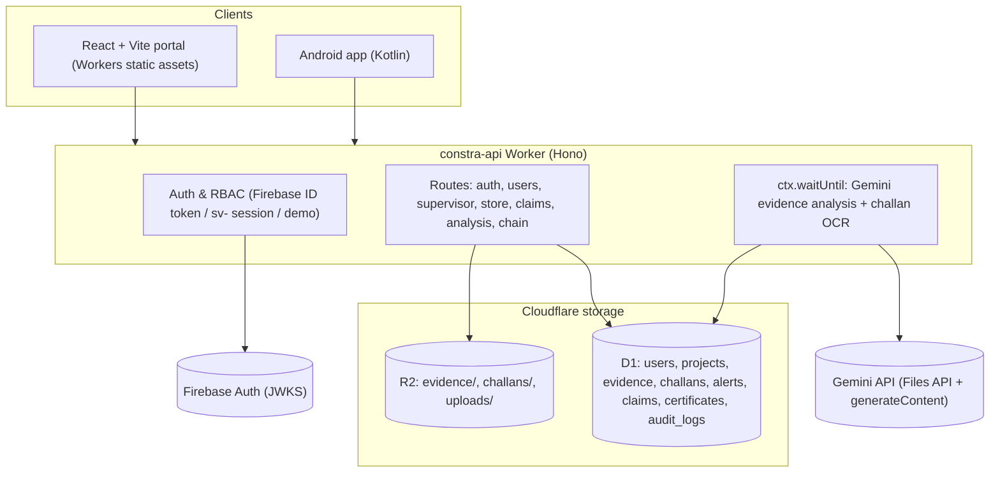
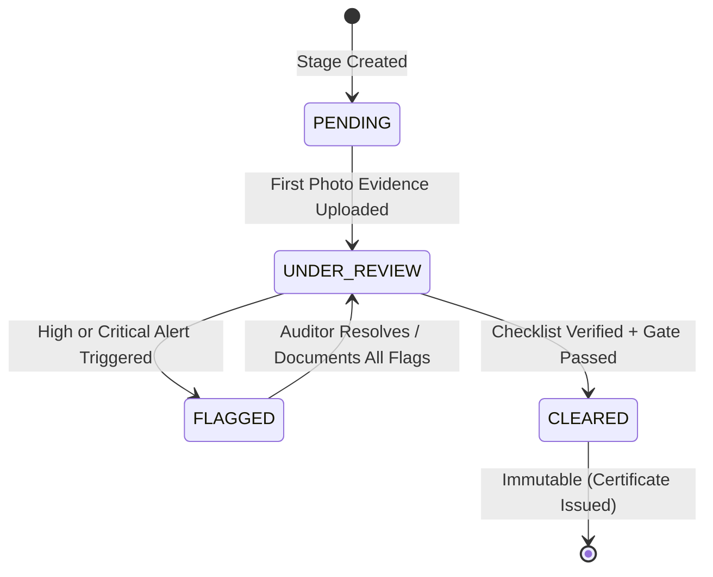

# CONSTRA: Multi-Stage Construction Milestone Verifier & Anti-Fraud Platform

> **CONSTRA is an automated construction site-audit and civil fraud prevention platform leveraging Vision-Language Models (VLM), delivery challan OCR reconciliation, EXIF geospatial forensics, statistical material anomaly detection, and tamper-evident evidence hashing to prevent milestone fraud and gate payment certification.**

[](#)
[](#)
[](#)
[](#)
[](#)

---

## 📋 Table of Contents

- [Executive Summary](#-executive-summary)
- [The Problem: Construction Fraud & Disconnects](#-the-problem-construction-fraud--disconnects)
- [System Architecture](#-system-architecture)
- [Core Verification Modules](#-core-verification-modules)
  - [1. Photo Evidence & VLM Stage Audit](#1-photo-evidence--vlm-stage-audit)
  - [2. Metadata & EXIF Tamper Detection](#2-metadata--exif-tamper-detection)
  - [3. Challan OCR & BOQ Reconciliation](#3-challan-ocr--boq-reconciliation)
  - [4. Material Consumption Anomaly Engine](#4-material-consumption-anomaly-engine)
  - [5. Milestone Clearance & Certificate Gating](#5-milestone-clearance--certificate-gating)
  - [6. Evidence Storage & Anchoring](#6-evidence-storage--anchoring)
- [MST Blockchain Integration](#-mst-blockchain-integration)
- [User Personas & Role-Based Access Control](#-user-personas--role-based-access-control)
- [Milestone State Machine](#-milestone-state-machine)
- [Technology Stack](#-technology-stack)
- [Project Directory Structure](#-project-directory-structure)
- [REST API Reference](#-rest-api-reference)
- [Security & Anti-Fraud Defenses](#-security--anti-fraud-defenses)
- [Configuration & Thresholds](#-configuration--thresholds)
- [Getting Started & Local Setup](#-getting-started--local-setup)
- [5-Minute Demo Walkthrough](#-5-minute-demo-walkthrough)
- [Project Documentation Index](#-project-documentation-index)

---

## 🚀 Executive Summary

General contractors and infrastructure developers routinely lose up to 10–15% of project capital to fabricated progress claims, ghost deliveries, and off-book material diversion. In traditional construction monitoring, milestone payments are approved based on paper challans, self-reported spreadsheets, and easily manipulated photo albums.

**CONSTRA** changes this paradigm by turning milestone verification into an automated, multi-source evidence pipeline:
- **Vision-Language Models (VLM)** audit stage completion photos against contract stage descriptions.
- **EXIF Forensics & SHA-256 Hashing** catch off-site spoofing, recycled photos, and edited timestamps.
- **OCR & Unit Normalization** extract line items from vendor delivery slips (challans) and reconcile them with the Bill of Quantities (BOQ).
- **Progress-Tied Anomaly Detection** flags abnormal consumption ratios and statistical $z$-score deviations.
- **Private R2 Evidence Storage** serves media only through authorized API routes.
- **MST Blockchain anchoring** records every evidence photo, challan and clearance certificate fingerprint in the `EvidenceRegistry` contract; auditors sign certificates with their BridgeKey wallet.
- **Cryptographically Gated Certificates** strictly prevent milestone certificate issuance whenever open critical alerts exist.

---

## 🚨 The Problem: Construction Fraud & Disconnects

```
┌────────────────────────────────────────────────────────────────────────────────────────┐
│                                Traditional Site Audit Reality                           │
├─────────────────────┬───────────────────────┬───────────────────┬──────────────────────┤
│ Fabricated Claims   │ Paper Challan Holes   │ Material Leakage  │ Unverified Photos    │
│ Subcontractors bill │ Delivery slips signed │ Excess material   │ Stock photos, photos │
│ for finished stages │ without verifying BOQ │ issued & quietly  │ from other sites, or │
│ before actual work  │ allocation or valid   │ diverted off-site │ stale timestamps     │
│ has completed.      │ vendor identity.      │ before usage.     │ submitted as proof.  │
└─────────────────────┴───────────────────────┴───────────────────┴──────────────────────┘
```

---

## 🏗️ System Architecture

**CONSTRA** runs entirely on Cloudflare's free plan: a static React frontend (Workers static assets), a Hono API Worker, a D1 (SQLite) database and an R2 bucket for evidence files. Firebase is used only for Google/email sign-in; Gemini provides vision analysis and challan OCR.



Evidence fingerprints are anchored on **MST Blockchain** by a relayer inside the API Worker (Cron Trigger + `waitUntil`); auditors sign clearance certificates from **BridgeKey**. See [MST Blockchain Integration](#-mst-blockchain-integration) and [architecture.md](architecture.md).

---

## 🔍 Core Verification Modules

### 1. Photo Evidence & VLM Stage Audit
- **Role-based prompt injection:** Evaluates site images against stage requirements (e.g., *"Steel mesh laid, shuttering fixed, concrete poured and leveled"*).
- **Structured JSON contracts:** Returns boolean match verdict, confidence score ($0-100$), checklist of visible elements, missing elements, and human-readable explanation.
- **Safety guardrail:** Explicit system prompts treat all text found within images as passive data, mitigating physical/visual prompt injection attacks.

### 2. Metadata & EXIF Tamper Detection
- **Geofence validation:** Computes Haversine distance between EXIF GPS coordinates and project site coordinates ($\le 200\text{ m}$ default radius).
- **Temporal freshness check:** Flags photos captured outside configured project thresholds (default 24 hours from upload) or timestamps set in the future.
- **Integrity tags:** Detects image-editing software metadata (`Photoshop`, `Canva`, etc.).
- **SHA-256 image fingerprinting:** Instantly detects exact duplicate evidence reused across different stages or projects.

### 3. Challan OCR & BOQ Reconciliation
- **Vision OCR:** Challan photos/PDFs are read by Gemini (Claude vision as optional fallback for images); Tesseract/OpenCV cannot run on Workers.
- **Field extraction:** Pulls vendor name, challan number, date, and line items (material, quantity, unit).
- **Human-in-the-loop review:** Low-confidence fields are highlighted in amber for Store In-Charge confirmation before database commitment.
- **BOQ Variance Reconciler:** Normalizes disparate units (bags, kg, metric tonnes) into base units and computes variance against planned BOQ limits with automated over-delivery alerts ($> 5\%$).

### 4. Material Consumption Anomaly Engine
- **Method A — Expected-Usage Ratio:** Directly ties allowable material consumption to **photo-verified completed progress**, preventing early material depletion on unverified claims.
- **Method B — Historical $z$-Score Analysis:** Computes rolling drawdown statistics once baseline history exists ($\ge 5$ records), flagging unusual spikes where $|z| > 2.5$.
- **Cumulative Threshold Guard:** Evaluates aggregate material issues per stage to stop attackers from avoiding detection through repeated small issues.

### 5. Milestone Clearance & Certificate Gating
- Clearance is gated by a strict server-side and database-trigger rule:
  $$\text{Can Clear} \iff \text{Photo Verified} \land \text{Metadata Valid} \land \text{Material Reconciled} \land \neg(\text{Open Critical Alerts}) \land (\text{Approver} \ne \text{Submitter})$$
- Generates a tamper-evident PDF milestone certificate containing a complete snapshot of evidence hashes, verification check outcomes, timestamps, and auditor credentials.

### 6. Evidence Storage & Anchoring
- **R2 storage:** Evidence photos and challans are stored privately in R2 and served only through authorized API routes (`/supervisor/evidence/{id}/file`, `/store/files/{id}`). Analysis images are served from `/uploads/{name}`.
- **MST anchoring:** Each evidence/challan/certificate SHA-256 is queued in D1 and anchored in `EvidenceRegistry` on MST. `/chain/verify/{sha256}`, `POST /chain/verify` and the public `/verify` page read the contract directly; a D1/chain mismatch is logged as tampering.

---

## 👥 User Personas & Role-Based Access Control

**CONSTRA** enforces separation of duties across three specialized roles:

| Role | Primary User | Core Responsibilities | Interface Focus |
| :--- | :--- | :--- | :--- |
| **Site Supervisor** | Field Engineer / Site Foreman | Uploads stage progress photos, reviews automated check results, addresses photo discrepancies | Mobile-first, high contrast, camera-friendly |
| **Store In-Charge** | Inventory / Warehouse Manager | Scans incoming vendor challans, verifies OCR fields, logs material drawdowns | Tablet / desktop, fast keyboard input |
| **Project Auditor** | Quality / Financial Controller | Sets up projects and BOQs, investigates flagged alerts, approves/rejects stages, issues certificates | Desktop command center, side-by-side evidence inspection |

### Permissions Matrix

| Capability | Supervisor | Store In-Charge | Auditor |
| :--- | :---: | :---: | :---: |
| View Assigned Project Stages | ✅ | ✅ | ✅ |
| Upload Milestone Photos | ✅ | ❌ | ❌ |
| Upload Delivery Challans & Issue Material | ❌ | ✅ | ❌ |
| Configure Projects, Stages & BOQ Limits | ❌ | ❌ | ✅ |
| Review / Resolve / Escalate Alerts | Submissions Only | Submissions Only | ✅ (All) |
| Tune Per-Project Alert Thresholds | ❌ | ❌ | ✅ |
| Approve Stage & Issue Milestone Certificate | ❌ | ❌ | ✅ *(Cannot approve self-submitted stages)* |
| Access Hash-Chained Audit Trail | ❌ | ❌ | ✅ |

---

## 🔄 Milestone State Machine

Every construction stage strictly moves through a deterministic finite state machine (FSM). Stages cannot jump states or clear silently.



- **PENDING:** Stage initialized with BOQ allocation and textual specifications.
- **UNDER_REVIEW:** Evidence uploaded; background EXIF, VLM, and reconciliation checks running or passed.
- **FLAGGED:** At least one high or critical alert has been raised (location deviation, VLM mismatch, over-delivery, consumption anomaly).
- **CLEARED:** Final immutable state. Achieved only when all checks pass and the Auditor executes a signed approval transaction.

---

## ⛓️ MST Blockchain Integration

| Item | Value |
| :--- | :--- |
| Contract | `EvidenceRegistry` ([contracts/](contracts/)) |
| MST Testnet address | _pending deploy — fill from `contracts/deployments.json`_ |
| MST Mainnet address | _pending deploy_ |
| Testnet tx hashes | _relayer `anchorMany` / auditor certificate txs — add after first run_ |
| Networks | Testnet chain `91562037` (`testnetrpc.mstblockchain.com`), Mainnet chain `4646` (`mariorpc.mstblockchain.com`) |
| Explorer | https://testnet.mstscan.com · https://mstscan.com |
| Wallet | BridgeKey (EIP-6963/EIP-1193) |

How MST is used (not a bolt-on):
1. **Evidence & challans:** every supervisor photo and confirmed delivery challan hash is queued and anchored by the CONSTRA relayer with `anchorMany` (batches ≤ 50, legacy `gasPrice`, retries, receipt confirmation).
2. **Clearance certificates:** the auditor links a BridgeKey wallet (signed message → on-chain `setAnchorer`) and signs `anchor(certificateHash, 3)` themselves; the backend accepts it only after checking the MST receipt and `Anchored` event.
3. **Verification:** anyone can check a file on `/verify` (browser hashes it, reads the contract over the public RPC). The API cross-checks D1 against the chain and flags tampering.

Details: [docs/CHAIN_INTEGRATION.md](docs/CHAIN_INTEGRATION.md), [docs/MST-BLOCKCHAIN.md](docs/MST-BLOCKCHAIN.md).

---

## 💻 Technology Stack

| Layer | Choice | Notes |
| :--- | :--- | :--- |
| **Web Portal** | React 19 + Vite + Tailwind CSS + GSAP + Lenis | Deployed as Cloudflare Workers static assets (SPA fallback) |
| **Mobile App** | Kotlin + Jetpack Compose + CameraX | On-site capture with EXIF GPS and offline queueing |
| **Backend API** | Cloudflare Workers + Hono (TypeScript) | No cold starts; ~10 ms CPU per request on the free plan |
| **Database** | Cloudflare D1 (SQLite) | Schema + demo seed in `backend/migrations/` |
| **File Storage** | Cloudflare R2 | Private evidence/challan files with stored SHA-256 checksums |
| **AI / Multimodal** | Gemini (Files API) / optional Claude vision | Construction analysis, image descriptions, challan OCR |
| **Forensics** | exifr + Haversine + z-scores | EXIF GPS/timestamp/software checks; consumption anomalies |
| **Auth** | Firebase Auth (ID tokens verified with `jose`) + HMAC session tokens + PBKDF2 | Roles always loaded from D1 |
| **Blockchain** | MST Blockchain + Solidity 0.8.24 + Hardhat + viem + BridgeKey | Evidence/certificate anchoring and trustless verification |

---

## 📁 Project Directory Structure

```
CONSTRA/
├── backend/                 # Cloudflare Worker API (Hono + D1 + R2)
│   ├── src/index.ts         # App entry: CORS, routes, error handler
│   ├── src/auth.ts          # Firebase/session/demo auth, RBAC, project access
│   ├── src/routes/          # auth, users, pings, supervisor, store, claims, analysis, chain
│   ├── src/services/        # store domain logic (units, stock, anomaly, reconcile, OCR), chain
│   ├── src/lib/             # exif, gemini, fuzzy matching, hashing utilities
│   ├── migrations/          # D1 schema + demo seed
│   ├── test/                # vitest unit tests
│   └── wrangler.json        # Worker config + D1/R2/rate-limit bindings
├── frontend/                # React 19 + Vite portal
├── wrangler.json            # Frontend Worker (static assets from frontend/dist)
├── Mobile App/              # Android field capture app
├── contracts/               # EvidenceRegistry (Solidity, Hardhat) deployed on MST testnet/mainnet
└── docs/
```

---

## 📡 REST API Reference

Errors use FastAPI-compatible bodies: `{"detail": ...}`.

| Method | Endpoint | Roles | Description |
| :--- | :--- | :--- | :--- |
| `GET` | `/health`, `/api/health` | Public | Health + whether Gemini is configured |
| `POST` | `/auth/login` | Firebase token | Sign in with a Firebase ID token (rate limited) |
| `POST` | `/auth/login-password` | Public | Email/password sign-in; returns `sv-` session token (rate limited) |
| `POST` | `/auth/demo-login` | Public (`DEMO_MODE`) | Demo sign-in per role |
| `GET` | `/auth/me` | Any | Current user |
| `GET/POST/PATCH/DELETE` | `/users`, `/users/{id}` | Auditor | Allowlist management |
| `GET` | `/supervisor/projects`, `/supervisor/projects/{pid}/stages`, `/supervisor/dashboard` | Supervisor | Assigned projects and stats |
| `POST` | `/supervisor/evidence` | Supervisor | Camera evidence upload (hash, geofence, alerts, AI analysis) |
| `GET/POST` | `/supervisor/evidence[/{id}[/retry-ai, /retry-anchor, /anchor, /file]]` | Supervisor (file: + Auditor) | Evidence history, retries, private file |
| `GET` | `/store/projects`, `/store/materials`, `/store/vendors`, `/store/projects/{pid}/{stages,materials,vendors}` | All roles | Reference data |
| `POST` | `/store/projects/{pid}/challans`, `/store/projects/{pid}/challans/manual` | Store In-Charge | Challan upload (OCR) or manual draft |
| `GET/PUT/PATCH` | `/store/challans/{id}`, `/store/deliveries/{id}` | Store, Auditor (edit: Store) | Challan detail and draft edit (optimistic locking) |
| `POST` | `/store/challans/{id}/confirm` | Store In-Charge | Confirm + BOQ reconciliation + alerts |
| `GET` | `/store/projects/{pid}/{challans,material-issues,stock-summary,boq-status,alerts}` | Store, Auditor | Lists and stock/BOQ status |
| `GET` | `/store/files/{id}?token=` | Store, Auditor | Private challan file |
| `POST` | `/store/issue-preview`, `/store/stages/{sid}/material-issues` | Store In-Charge | Anomaly preview and material issue |
| `PATCH/POST` | `/store/alerts/{id}`, `/store/alerts/{id}/action` | Auditor, Store | Resolve/escalate with justification |
| `POST` | `/api/analyze-image` | Public (user optional) | Gemini description + EXIF report |
| `GET` | `/api/analyses`, `/uploads/{name}` | Public | Past analyses, analysis images |
| `GET/POST` | `/api/v1/claims[/{id}[/commands, /decisions]]`, `/api/v1/jobs/{id}` | Public | Claims audit desk |
| `POST` | `/api/v1/claims/{id}/submit` | Auditor | Approve/reject with clearance gate and certificate |
| `GET` | `/api/v1/claims/{id}/certificate`, `/api/v1/stages/{id}/certificate` | Public | Clearance certificates |
| `GET` | `/chain/config` | Public | MST network, RPC, explorer, contract address |
| `POST/GET` | `/chain/verify`, `/chain/verify/{sha256}` | Public (rate limited) | On-chain fingerprint verification |
| `GET/POST` | `/chain/wallet/message`, `/chain/wallet` | Auditor | Link BridgeKey wallet (signature) → on-chain `setAnchorer` |
| `POST` | `/chain/certificates/{id}/onchain` | Auditor | Submit wallet-signed certificate tx (receipt verified) |
| `POST` | `/chain/process` | Auditor | Run the MST relayer now |
| `GET/POST` | `/chain/anchors/{entity}/{id}`, `/chain/status`, `/chain/anchors/{sha}/retry` | Any / Auditor | Anchor status, relayer health, retry |

--- | :--- | :--- | :--- |
| `POST` | `/api/v1/auth/login` | Public | Authenticates user; returns JWT bearer token |
| `POST` | `/api/v1/projects` | Auditor | Initializes new project with geofence coordinates and radius |
| `POST` | `/api/v1/projects/{id}/stages` | Auditor | Configures sequential construction stages & specifications |
| `POST` | `/api/v1/projects/{id}/boq` | Auditor | Uploads planned Bill of Quantities allocations |
| `POST` | `/api/v1/stages/{id}/photos` | Supervisor | Ingests stage photo evidence, triggers async verification pipeline |
| `GET` | `/api/v1/stages/{id}/verification` | Supervisor, Auditor | Polls check outcomes, evidence status, and open alerts |
| `POST` | `/api/v1/projects/{id}/challans` | Store In-Charge | Ingests vendor delivery slip scan for OCR extraction |
| `PUT` | `/api/v1/challans/{id}` | Store In-Charge | Saves human-corrected OCR values; triggers BOQ reconciliation |
| `POST` | `/api/v1/stages/{id}/material-issues` | Store In-Charge | Records material issuance and evaluates anomaly metrics |
| `GET` | `/api/v1/alerts` | Auditor | Retrieves active alert triage queue filtered by severity and stage |
| `PATCH` | `/api/v1/alerts/{id}` | Auditor | Resolves or escalates an alert (mandatory written justification) |
| `POST` | `/api/v1/stages/{id}/approve` | Auditor | Evaluates clearance gate and marks stage `CLEARED` |
| `GET` | `/api/v1/stages/{id}/certificate` | Supervisor, Auditor | Generates and downloads signed milestone clearance PDF certificate |
| `POST` | `/api/v1/chain/anchor` | Relayer / Internal | Submits batch of SHA-256 evidence fingerprints to smart contract |
| `GET` | `/api/v1/chain/verify/{fingerprint}`| Public | Verifies evidence fingerprint and returns on-chain proof |
| `GET` | `/api/v1/chain/status` | Public | Returns blockchain relayer health, contract address, and network |

---

## 🛡️ Security & Anti-Fraud Defenses

**CONSTRA** applies the **STRIDE** threat model and enforces robust integrity controls:

```
┌────────────────────────────────────────────────────────────────────────────────────────┐
│                                 Anti-Fraud Shield Matrix                               │
├──────────────────────────┬─────────────────────────────────────────────────────────────┤
│ Threat Vector            │ System Defense                                              │
├──────────────────────────┼─────────────────────────────────────────────────────────────┤
│ Recycled Old Photos      │ Rejection based on EXIF capture age vs. upload time.       │
│ Off-Site Photo Capture   │ Haversine boundary check against site coordinates.          │
│ Photo Editing / Spoofing │ Flagging of editor tags + duplicate SHA-256 hash checks.    │
│ Visual Prompt Injection  │ Strict system instructions ignoring text commands in images.│
│ Inflated Challan Paper   │ Dual-layer review: OCR + human confirm + BOQ tolerance cap. │
│ Ghost Material Issues    │ Material consumption tied strictly to photo-verified stages.│
│ Self-Approval Collusion  │ Enforced separation of submitter and approver IDs in DB.    │
│ Tampered Audit Logs      │ Cryptographic SHA-256 hash chaining of all historical rows.  │
└──────────────────────────┴─────────────────────────────────────────────────────────────┘
```

- **Cryptographic Audit Log:** Each audit entry contains `row_hash = SHA256(prev_hash + actor_id + action + timestamp + detail)`. Tampering with any historical database row breaks the cryptographic chain.
- **Strict File Upload Hardening:** Verification of file magic bytes (not just extensions), $10\text{ MB}$ size enforcement, randomized UUID file names stored outside the web root, and retention of untouched original EXIF data for auditability.

---

## ⚙️ Configuration & Thresholds

Project thresholds are fully configurable in the database on a per-project basis, preventing hardcoded assumptions across different construction types:

```yaml
thresholds:
  site_radius_m: 200                # Permissible distance from project centroid (meters)
  max_capture_age_hours: 24         # Maximum allowed time between photo capture and upload
  vlm_min_confidence: 70            # Minimum VLM confidence percentage before raising alert
  boq_tolerance_pct: 5              # Allowable delivery variance beyond planned quantity (%)
  zscore_limit: 2.5                 # Standard deviation threshold for anomalous consumption
  expected_usage_tolerance: 0.15    # Allowable usage buffer (15%) above theoretical BOQ norm
limits:
  max_upload_mb: 10                 # Maximum upload payload size per photo / challan
```

---

## ⚡ Getting Started & Local Setup

### Prerequisites
- Node.js 20+ and npm
- A Cloudflare account (free plan) for deployment

### Local development
```bash
# 1. Backend Worker (http://localhost:8787)
cd backend
npm install
cp .dev.vars.example .dev.vars        # fill in SECRET_KEY (any long random string), GEMINI_API_KEY, ...
npm run db:migrate:local              # creates the local D1 database with demo data
npm run dev                           # add `-- --ip 0.0.0.0` to reach it from a phone on your LAN
npm test                              # unit tests

# 2. Frontend (http://localhost:5173)
cd ../frontend
cp .env.example .env                  # VITE_API_BASE_URL=http://localhost:8787
npm install && npm run dev
```

Demo logins (`DEMO_MODE=true`): use the role buttons on the login page, or send `Authorization: Bearer demo-supervisor | demo-store | demo-auditor`.

### Deploy to Cloudflare (free plan)
Run these yourself (nothing here logs in for you):
```bash
npx wrangler login
cd backend
npx wrangler d1 create constra-db         # paste the printed database_id into backend/wrangler.json
npx wrangler r2 bucket create constra-files
npx wrangler secret put SECRET_KEY         # long random string; signs sv- session tokens
npx wrangler secret put GEMINI_API_KEY
npx wrangler secret put BOOTSTRAP_ADMIN_EMAIL      # optional: first auditor account
npx wrangler secret put BOOTSTRAP_ADMIN_PASSWORD   # optional
npx wrangler secret put ANCHOR_PRIVATE_KEY         # MST relayer wallet = EvidenceRegistry owner
cd ../contracts && cp .env.example .env            # PRIVATE_KEY (same wallet), fund it from the faucet
npm install && npm run deploy:testnet              # put the printed address in backend/wrangler.json CONTRACT_ADDRESS
cd ..
npm run deploy                              # applies D1 migrations, deploys the API, builds + deploys the frontend
```
- The frontend calls `https://constra-api.pranavms09.workers.dev` by default in production; override with `VITE_API_BASE_URL` at build time.
- Add any custom frontend domain to `FRONTEND_ORIGINS` in `backend/wrangler.json` (exact origins only; CORS has no wildcard).
- Set `DEMO_MODE` to `"false"` in `backend/wrangler.json` before using real data: demo tokens bypass authentication.
- Mainnet: `CONFIRM_MAINNET="yes, deploy to mainnet" npm run deploy:mainnet` in `contracts/`, then set `MST_NETWORK=mainnet`, `MST_CHAIN_ID=4646`, `MST_RPC_URL=https://mariorpc.mstblockchain.com`, `MST_EXPLORER_URL=https://mstscan.com`, `CONTRACT_ADDRESS` in `backend/wrangler.json`.
- Local dev without a wallet: add `CHAIN_MODE=fake` to `backend/.dev.vars` (simulated anchors).

### Free-plan limits to know
- ~100k requests/day and ~10 ms CPU per request. Large uploads are hashed natively and sent to Gemini through the Files API (no base64), but very large photos can still exceed the CPU budget.
- Background AI analysis and challan OCR run via `ctx.waitUntil` (about 30 s after the response). If they regularly time out, move them to Cloudflare Queues.

## 🔐 Firebase Authentication

1. **Zero frontend trust:** roles are loaded from D1, never from the client or token.
2. **Token verification:** Firebase ID tokens are verified against Google's public keys (signature, issuer, audience, expiry). Unsigned tokens are rejected.
3. **Verified emails only** for Google sign-in; logins and denials are written to `audit_logs`.

Setup: create a Firebase project, enable Google sign-in, register a Web App and put its config in `frontend/.env`. The Worker only needs `FIREBASE_PROJECT_ID` (no service-account key).

---

## 🎬 5-Minute Demo Walkthrough

To experience the complete verification lifecycle during a live presentation:

1. **Genuine Stage Upload:** Log in as **Site Supervisor** (`supervisor@siteverify.com`). Upload an authentic site photo for *Column Casting*. All checks (GPS, timestamp, VLM) pass; status updates to `UNDER_REVIEW`.
2. **Fabricated Photo Injection:** Upload a photo of bare ground for *Slab Casting*. VLM identifies missing reinforcement steel ($82\%$ confidence) and raises a `CRITICAL` alert; status transitions to `FLAGGED`.
3. **Location Tamper Attempt:** Upload a photo taken $410\text{ m}$ away. The EXIF checker flags a `HIGH` alert for geofence violation.
4. **Duplicate Photo Reuse:** Upload the earlier column photo under a different stage. SHA-256 duplicate detection flags it instantly.
5. **Inflated Challan Delivery:** Log in as **Store In-Charge** (`store@siteverify.com`). Upload a vendor challan with $24\%$ excess cement. Confirm OCR; BOQ engine flags over-delivery.
6. **Anomalous Material Issue:** Issue 40 bags of cement when only 15 are expected for current verified work. Anomaly engine flags consumption deviation.
7. **Certificate Gate Enforcement:** Log in as **Project Auditor** (`auditor@siteverify.com`). Attempt to approve the flagged stage. System **blocks certificate issuance** with explicit blocker tooltips.
8. **Resolution & Certificate Generation:** Auditor reviews evidence panel, documents override comments, resolves alerts, and approves the stage. The system clears the stage, issues a SHA-256-sealed clearance certificate stored in D1.

---

## 📚 Project Documentation Index

For in-depth technical specifications, browse the accompanying documentation suite:

| Document | Description |
| :--- | :--- |
| [1. PRD - Multi-Stage Construction Milestone Verifier.md](./docs/1.%20PRD%20-%20Multi-Stage%20Construction%20Milestone%20Verifier.md) | **Product Requirements Document:** User personas, functional requirements (FR-1 to FR-9), user stories, and acceptance criteria. |
| [2. TRD - Multi-Stage Construction Milestone Verifier.md](./docs/2.%20TRD%20-%20Multi-Stage%20Construction%20Milestone%20Verifier.md) | **Technical Requirements Document:** Architecture diagrams, module specifications, algorithms, and test plans. |
| [3. UI UX Design Document.md](./docs/3.%20UI%20UX%20Design%20Document.md) | **UI/UX Design Document:** User journeys, text wireframes, design tokens, responsive breakpoints, and microcopy guidelines. |
| [5. Security Document.md](./docs/5.%20Security%20Document.md) | **Security Document:** Threat model (STRIDE), insider fraud defenses (F1–F14), cryptographic audit chains, and upload safety. |
| [6. System Design Document.md](./docs/6.%20System%20Design%20Document.md) | **System Design Document:** Modular monolith breakdown, extensible check pipelines, sequence diagrams, and trade-off rationales. |

---

## 👥 Contributors & Acknowledgements

Developed for **MST Buildathon 2026**. Designed to bring transparency, accountability, and automated rigor to construction milestone auditing.
