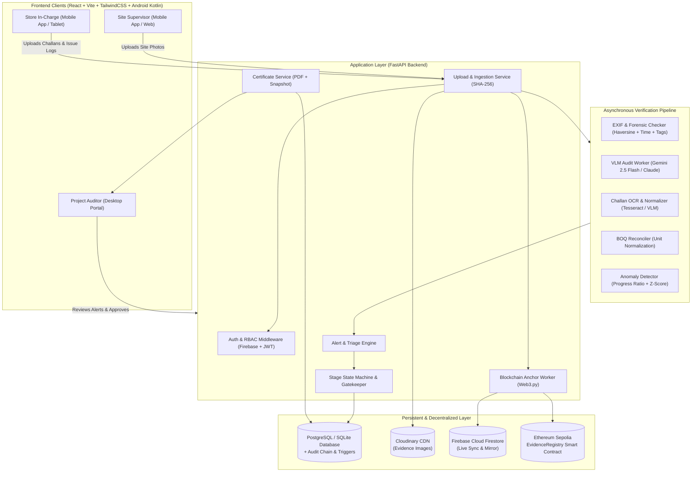
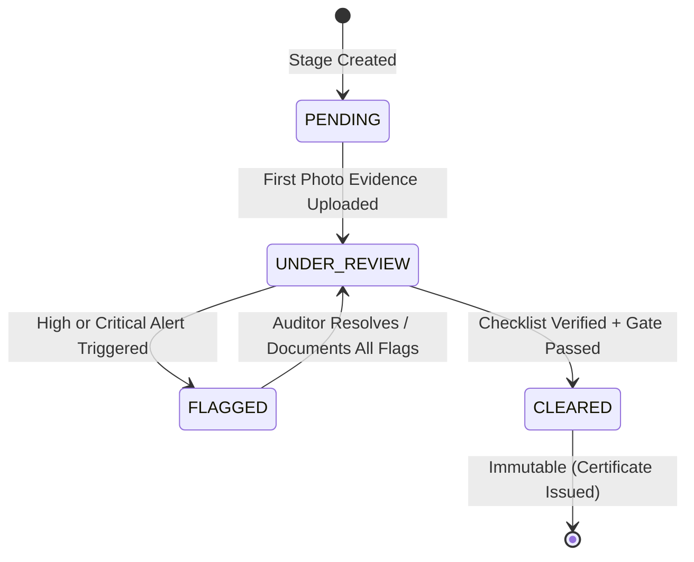

# CONSTRA: Multi-Stage Construction Milestone Verifier & Anti-Fraud Platform

> **CONSTRA is an automated construction site-audit and civil fraud prevention platform leveraging Vision-Language Models (VLM), delivery challan OCR reconciliation, EXIF geospatial forensics, statistical material anomaly detection, Cloudinary CDN storage, and immutable blockchain anchoring to prevent milestone fraud and gate payment certification.**

[](#)
[](#)
[](#)
[](#)
[](#)
[](#)

---

## 📋 Table of Contents

- [Executive Summary](#-executive-summary)
- [The Problem: Construction Fraud & Disconnects](#-the-problem-construction-fraud--disconnects)
- [System Architecture](#-system-architecture)
- [Core Verification Modules](#-core-verification-modules)
  - [1. Photo Evidence & VLM Stage Audit](#1-photo-evidence--vlm-stage-audit)
  - [2. Metadata & EXIF Tamper Detection](#2-metadata--exif-tamper-detection)
  - [3. Challan OCR & BOQ Reconciliation](#3-challan-ocr--boq-reconciliation)
  - [4. Material Consumption Anomaly Engine](#4-material-consumption-anomaly-engine)
  - [5. Milestone Clearance & Certificate Gating](#5-milestone-clearance--certificate-gating)
  - [6. Blockchain Evidence Anchoring & Cloudinary CDN](#6-blockchain-evidence-anchoring--cloudinary-cdn)
- [User Personas & Role-Based Access Control](#-user-personas--role-based-access-control)
- [Milestone State Machine](#-milestone-state-machine)
- [Technology Stack](#-technology-stack)
- [Project Directory Structure](#-project-directory-structure)
- [REST API Reference](#-rest-api-reference)
- [Security & Anti-Fraud Defenses](#-security--anti-fraud-defenses)
- [Configuration & Thresholds](#-configuration--thresholds)
- [Getting Started & Local Setup](#-getting-started--local-setup)
- [5-Minute Demo Walkthrough](#-5-minute-demo-walkthrough)
- [Project Documentation Index](#-project-documentation-index)

---

## 🚀 Executive Summary

General contractors and infrastructure developers routinely lose up to 10–15% of project capital to fabricated progress claims, ghost deliveries, and off-book material diversion. In traditional construction monitoring, milestone payments are approved based on paper challans, self-reported spreadsheets, and easily manipulated photo albums.

**CONSTRA** changes this paradigm by turning milestone verification into an automated, multi-source evidence pipeline:
- **Vision-Language Models (VLM)** audit stage completion photos against contract stage descriptions.
- **EXIF Forensics & SHA-256 Hashing** catch off-site spoofing, recycled photos, and edited timestamps.
- **OCR & Unit Normalization** extract line items from vendor delivery slips (challans) and reconcile them with the Bill of Quantities (BOQ).
- **Progress-Tied Anomaly Detection** flags abnormal consumption ratios and statistical $z$-score deviations.
- **Cloudinary CDN Distribution** serves evidence media reliably across all authority dashboards.
- **Ethereum Sepolia Smart Contract Anchoring** creates immutable proof-of-existence for milestone evidence and clearance certificates.
- **Cryptographically Gated Certificates** strictly prevent milestone certificate issuance whenever open critical alerts exist.

---

## 🚨 The Problem: Construction Fraud & Disconnects

```
┌────────────────────────────────────────────────────────────────────────────────────────┐
│                                Traditional Site Audit Reality                           │
├─────────────────────┬───────────────────────┬───────────────────┬──────────────────────┤
│ Fabricated Claims   │ Paper Challan Holes   │ Material Leakage  │ Unverified Photos    │
│ Subcontractors bill │ Delivery slips signed │ Excess material   │ Stock photos, photos │
│ for finished stages │ without verifying BOQ │ issued & quietly  │ from other sites, or │
│ before actual work  │ allocation or valid   │ diverted off-site │ stale timestamps     │
│ has completed.      │ vendor identity.      │ before usage.     │ submitted as proof.  │
└─────────────────────┴───────────────────────┴───────────────────┴──────────────────────┘
```

---

## 🏗️ System Architecture

**CONSTRA** is engineered as a **Modular Monolith** with clear bounded contexts, asynchronous AI task execution, an extensible verification pipeline, Cloudinary CDN delivery, and immutable Ethereum Sepolia blockchain anchoring.



---

## 🔍 Core Verification Modules

### 1. Photo Evidence & VLM Stage Audit
- **Role-based prompt injection:** Evaluates site images against stage requirements (e.g., *"Steel mesh laid, shuttering fixed, concrete poured and leveled"*).
- **Structured JSON contracts:** Returns boolean match verdict, confidence score ($0-100$), checklist of visible elements, missing elements, and human-readable explanation.
- **Safety guardrail:** Explicit system prompts treat all text found within images as passive data, mitigating physical/visual prompt injection attacks.

### 2. Metadata & EXIF Tamper Detection
- **Geofence validation:** Computes Haversine distance between EXIF GPS coordinates and project site coordinates ($\le 200\text{ m}$ default radius).
- **Temporal freshness check:** Flags photos captured outside configured project thresholds (default 24 hours from upload) or timestamps set in the future.
- **Integrity tags:** Detects image-editing software metadata (`Photoshop`, `Canva`, etc.).
- **SHA-256 image fingerprinting:** Instantly detects exact duplicate evidence reused across different stages or projects.

### 3. Challan OCR & BOQ Reconciliation
- **Pre-processing pipeline:** Converts scans/photos using grayscale conversion, non-local means denoising, and Otsu adaptive binarization.
- **Field extraction:** Pulls vendor name, challan number, date, and line items (material, quantity, unit).
- **Human-in-the-loop review:** Low-confidence fields are highlighted in amber for Store In-Charge confirmation before database commitment.
- **BOQ Variance Reconciler:** Normalizes disparate units (bags, kg, metric tonnes) into base units and computes variance against planned BOQ limits with automated over-delivery alerts ($> 5\%$).

### 4. Material Consumption Anomaly Engine
- **Method A — Expected-Usage Ratio:** Directly ties allowable material consumption to **photo-verified completed progress**, preventing early material depletion on unverified claims.
- **Method B — Historical $z$-Score Analysis:** Computes rolling drawdown statistics once baseline history exists ($\ge 5$ records), flagging unusual spikes where $|z| > 2.5$.
- **Cumulative Threshold Guard:** Evaluates aggregate material issues per stage to stop attackers from avoiding detection through repeated small issues.

### 5. Milestone Clearance & Certificate Gating
- Clearance is gated by a strict server-side and database-trigger rule:
  $$\text{Can Clear} \iff \text{Photo Verified} \land \text{Metadata Valid} \land \text{Material Reconciled} \land \neg(\text{Open Critical Alerts}) \land (\text{Approver} \ne \text{Submitter})$$
- Generates a tamper-evident PDF milestone certificate containing a complete snapshot of evidence hashes, verification check outcomes, timestamps, and auditor credentials.

### 6. Blockchain Evidence Anchoring & Cloudinary CDN
- **Cloudinary CDN Integration:** Evidence photos captured from the Android app or web portal are uploaded directly to Cloudinary CDN, generating immutable secure HTTPS URLs accessible across all three role portals.
- **Ethereum Sepolia Anchoring:** An automated background worker calculates the SHA-256 evidence fingerprint and anchors it to the `EvidenceRegistry` smart contract on Sepolia testnet (`0x9B4E3d4b62e59B622d5E69cbea0393A6Ee8Fdd14`), recording block number, transaction hash, and timestamp.
- **Independent Verification:** Any auditor or regulator can verify the authenticity of a photo or completion certificate directly on Etherscan or via the `/api/v1/chain/verify/{fingerprint}` endpoint.

---

## 👥 User Personas & Role-Based Access Control

**CONSTRA** enforces separation of duties across three specialized roles:

| Role | Primary User | Core Responsibilities | Interface Focus |
| :--- | :--- | :--- | :--- |
| **Site Supervisor** | Field Engineer / Site Foreman | Uploads stage progress photos, reviews automated check results, addresses photo discrepancies | Mobile-first, high contrast, camera-friendly |
| **Store In-Charge** | Inventory / Warehouse Manager | Scans incoming vendor challans, verifies OCR fields, logs material drawdowns | Tablet / desktop, fast keyboard input |
| **Project Auditor** | Quality / Financial Controller | Sets up projects and BOQs, investigates flagged alerts, approves/rejects stages, issues certificates | Desktop command center, side-by-side evidence inspection |

### Permissions Matrix

| Capability | Supervisor | Store In-Charge | Auditor |
| :--- | :---: | :---: | :---: |
| View Assigned Project Stages | ✅ | ✅ | ✅ |
| Upload Milestone Photos | ✅ | ❌ | ❌ |
| Upload Delivery Challans & Issue Material | ❌ | ✅ | ❌ |
| Configure Projects, Stages & BOQ Limits | ❌ | ❌ | ✅ |
| Review / Resolve / Escalate Alerts | Submissions Only | Submissions Only | ✅ (All) |
| Tune Per-Project Alert Thresholds | ❌ | ❌ | ✅ |
| Approve Stage & Issue Milestone Certificate | ❌ | ❌ | ✅ *(Cannot approve self-submitted stages)* |
| Access Hash-Chained Audit Trail | ❌ | ❌ | ✅ |

---

## 🔄 Milestone State Machine

Every construction stage strictly moves through a deterministic finite state machine (FSM). Stages cannot jump states or clear silently.



- **PENDING:** Stage initialized with BOQ allocation and textual specifications.
- **UNDER_REVIEW:** Evidence uploaded; background EXIF, VLM, and reconciliation checks running or passed.
- **FLAGGED:** At least one high or critical alert has been raised (location deviation, VLM mismatch, over-delivery, consumption anomaly).
- **CLEARED:** Final immutable state. Achieved only when all checks pass and the Auditor executes a signed approval transaction.

---

## 💻 Technology Stack

| Layer | Component | Choice | Rationale |
| :--- | :--- | :--- | :--- |
| **Web Portal** | Framework & Styling | **React 19 + Vite + Tailwind CSS + GSAP + Lenis** | Ultra-responsive, drafting-grade CONSTRA UI with micro-motion and smooth inertia |
| **Mobile App** | Native Android | **Kotlin + Jetpack Compose + CameraX** | On-site photo capture with unstripped EXIF GPS metadata and offline queueing |
| **Backend API** | Application Server | **FastAPI (Python 3.12)** | Asynchronous ASGI runtime, native Pydantic v2 schemas, automated OpenAPI documentation |
| **Database** | Relational & Live Sync | **PostgreSQL / SQLite + Cloud Firestore** | ACID relational integrity with Alembic migrations and real-time Firestore mirror |
| **Media CDN** | Evidence Storage | **Cloudinary CDN** | Instant cross-dashboard image distribution with secure HTTPS access for all 3 roles |
| **Blockchain** | Decentralized Anchor | **Ethereum Sepolia + Web3.py + Hardhat** | Immutable proof-of-existence via `EvidenceRegistry.sol` smart contract |
| **AI / Multimodal** | VLM Audit Service | **Google Gemini 2.5 Flash / Claude Vision** | Deep visual reasoning over structural stage completion checklists |
| **Computer Vision** | OCR & Preprocessing | **OpenCV (`cv2`) + Tesseract (`pytesseract`)** | Local, zero-latency image filtering, adaptive thresholding, and challan parsing |
| **Forensics & Math** | Metadata & Anomaly | **Pillow / ExifRead + NumPy + Pandas** | Direct EXIF extraction, Haversine geospatial radius math, and rolling $z$-scores |
| **Security & Auth** | Cryptography & RBAC | **Firebase Auth + JWT + SHA-256** | Zero-trust token authentication and SHA-256 cryptographic evidence chaining |
| **Certificates** | Document Generation | **ReportLab / WeasyPrint** | High-fidelity, auditable PDF milestone certificate rendering |

---

## 📁 Project Directory Structure

The system follows a clean modular architecture:

```
CONSTRA/
├── backend/                            # FastAPI backend services & AI pipelines
│   ├── app/
│   │   ├── main.py                     # FastAPI entry point & middleware registration
│   │   ├── config.py                   # Environment settings & threshold loaders
│   │   ├── api/                        # HTTP Routers (claims, analysis)
│   │   ├── routers/                    # Domain routers (store, supervisor, chain, auth)
│   │   ├── checks/                     # Pluggable verification pipeline classes
│   │   ├── domain/                     # Pure domain logic: state machine, unit conversion
│   │   ├── models/                     # SQLAlchemy relational models
│   │   ├── schemas/                    # Pydantic v2 request/response schemas
│   │   ├── services/                   # Business logic (cloudinary_service, chain, firestore_db)
│   │   └── workers/                    # Background blockchain anchor worker
│   ├── .env                            # Consolidated environment secrets & configs
│   └── requirements.txt                # Python backend dependencies
├── frontend/                           # React 19 + Vite + Tailwind CSS portal
│   ├── src/
│   │   ├── api/                        # Typed API clients
│   │   ├── auth/                       # Firebase AuthContext & route guards
│   │   ├── components/                 # CONSTRA design system components
│   │   └── pages/                      # Role portals (supervisor, store, auditor, analysis)
│   ├── DESIGN.md                       # CONSTRA technical drafting specification
│   ├── package.json
│   └── vite.config.ts
├── Mobile App/                         # Native Android field evidence capture app (Kotlin)
├── contracts/                          # Ethereum Sepolia EvidenceRegistry smart contract
│   ├── contracts/EvidenceRegistry.sol  # Solidity immutable anchoring contract
│   └── hardhat.config.ts
├── docs/                               # System design, PRDs, and chain integration guides
└── README.md                           # Master project guide
```

---

## 📡 REST API Reference

| Method | Endpoint | Authorized Roles | Description |
| :--- | :--- | :--- | :--- |
| `POST` | `/api/v1/auth/login` | Public | Authenticates user; returns JWT bearer token |
| `POST` | `/api/v1/projects` | Auditor | Initializes new project with geofence coordinates and radius |
| `POST` | `/api/v1/projects/{id}/stages` | Auditor | Configures sequential construction stages & specifications |
| `POST` | `/api/v1/projects/{id}/boq` | Auditor | Uploads planned Bill of Quantities allocations |
| `POST` | `/api/v1/stages/{id}/photos` | Supervisor | Ingests stage photo evidence, triggers async verification pipeline |
| `GET` | `/api/v1/stages/{id}/verification` | Supervisor, Auditor | Polls check outcomes, evidence status, and open alerts |
| `POST` | `/api/v1/projects/{id}/challans` | Store In-Charge | Ingests vendor delivery slip scan for OCR extraction |
| `PUT` | `/api/v1/challans/{id}` | Store In-Charge | Saves human-corrected OCR values; triggers BOQ reconciliation |
| `POST` | `/api/v1/stages/{id}/material-issues` | Store In-Charge | Records material issuance and evaluates anomaly metrics |
| `GET` | `/api/v1/alerts` | Auditor | Retrieves active alert triage queue filtered by severity and stage |
| `PATCH` | `/api/v1/alerts/{id}` | Auditor | Resolves or escalates an alert (mandatory written justification) |
| `POST` | `/api/v1/stages/{id}/approve` | Auditor | Evaluates clearance gate and marks stage `CLEARED` |
| `GET` | `/api/v1/stages/{id}/certificate` | Supervisor, Auditor | Generates and downloads signed milestone clearance PDF certificate |
| `POST` | `/api/v1/chain/anchor` | Relayer / Internal | Submits batch of SHA-256 evidence fingerprints to smart contract |
| `GET` | `/api/v1/chain/verify/{fingerprint}`| Public | Verifies evidence fingerprint and returns on-chain proof |
| `GET` | `/api/v1/chain/status` | Public | Returns blockchain relayer health, contract address, and network |

---

## 🛡️ Security & Anti-Fraud Defenses

**CONSTRA** applies the **STRIDE** threat model and enforces robust integrity controls:

```
┌────────────────────────────────────────────────────────────────────────────────────────┐
│                                 Anti-Fraud Shield Matrix                               │
├──────────────────────────┬─────────────────────────────────────────────────────────────┤
│ Threat Vector            │ System Defense                                              │
├──────────────────────────┼─────────────────────────────────────────────────────────────┤
│ Recycled Old Photos      │ Rejection based on EXIF capture age vs. upload time.       │
│ Off-Site Photo Capture   │ Haversine boundary check against site coordinates.          │
│ Photo Editing / Spoofing │ Flagging of editor tags + duplicate SHA-256 hash checks.    │
│ Visual Prompt Injection  │ Strict system instructions ignoring text commands in images.│
│ Inflated Challan Paper   │ Dual-layer review: OCR + human confirm + BOQ tolerance cap. │
│ Ghost Material Issues    │ Material consumption tied strictly to photo-verified stages.│
│ Self-Approval Collusion  │ Enforced separation of submitter and approver IDs in DB.    │
│ Tampered Audit Logs      │ Cryptographic SHA-256 hash chaining of all historical rows.  │
└──────────────────────────┴─────────────────────────────────────────────────────────────┘
```

- **Cryptographic Audit Log:** Each audit entry contains `row_hash = SHA256(prev_hash + actor_id + action + timestamp + detail)`. Tampering with any historical database row breaks the cryptographic chain.
- **Strict File Upload Hardening:** Verification of file magic bytes (not just extensions), $10\text{ MB}$ size enforcement, randomized UUID file names stored outside the web root, and retention of untouched original EXIF data for auditability.

---

## ⚙️ Configuration & Thresholds

Project thresholds are fully configurable in the database on a per-project basis, preventing hardcoded assumptions across different construction types:

```yaml
thresholds:
  site_radius_m: 200                # Permissible distance from project centroid (meters)
  max_capture_age_hours: 24         # Maximum allowed time between photo capture and upload
  vlm_min_confidence: 70            # Minimum VLM confidence percentage before raising alert
  boq_tolerance_pct: 5              # Allowable delivery variance beyond planned quantity (%)
  zscore_limit: 2.5                 # Standard deviation threshold for anomalous consumption
  expected_usage_tolerance: 0.15    # Allowable usage buffer (15%) above theoretical BOQ norm
limits:
  max_upload_mb: 10                 # Maximum upload payload size per photo / challan
```

---

## ⚡ Getting Started & Local Setup

### Prerequisites
- Docker & Docker Compose (v2.0+)
- Python 3.11+ (for local backend development)
- Node.js 18+ & npm (for local frontend development)
- Tesseract OCR (`sudo apt-get install tesseract-ocr` on Debian/Ubuntu)

### Quickstart with Docker Compose

1. **Clone the repository:**
   ```bash
   git clone https://github.com/Pranavms09/CONSTRA.git
   cd CONSTRA
   ```

2. **Configure environment variables:**
   The backend uses a single consolidated configuration file at `backend/.env`:
   ```bash
   # Ensure backend/.env exists with your API keys (Gemini, Cloudinary, Alchemy Sepolia)
   ```

3. **Launch the platform:**
   ```bash
   docker compose up --build
   ```

4. **Access the applications:**
   - **Frontend UI:** `http://localhost:5173`
   - **Backend API & Swagger Docs:** `http://localhost:8000/docs`
   - **PostgreSQL Database:** `localhost:5432`

---

## 🔐 Feature 1: Role-Segregated Portal with Firebase Authentication

Feature 1 implements zero-trust role segregation with Google login powered by Firebase Authentication and the Firebase Admin SDK.

### Architecture & Security Guarantees
1. **Zero Frontend Trust**: Frontend never decides user permissions. Roles are loaded and verified strictly from the database using the verified Firebase token.
2. **Claimed Role Validation**: On login, the backend matches the requested operational role against `users.role`. Discrepancies immediately return `403 Forbidden` and cancel authentication.
3. **Allowlist Gating**: Unregistered Google accounts cannot access any system endpoint (`403: Your account is not registered. Contact your Auditor.`).
4. **Verified Emails Only**: Tokens with `email_verified=False` are rejected with `403`.
5. **Audit Logging**: Successful and rejected logins are recorded with timestamps, actions (`login`, `login_denied`), and reasons without storing sensitive tokens.

### Step 1: Firebase Project Setup
1. In the [Firebase Console](https://console.firebase.google.com/):
   - Create a Firebase Project (e.g. `constra-b561b`).
   - Under **Authentication** -> **Sign-in method**, enable **Google**.
2. Under **Project Settings** -> **General**:
   - Register a Web App and copy the web configuration keys.
3. Under **Project Settings** -> **Service accounts**:
   - Click **Generate new private key** and save the JSON file as `backend/secrets/firebase-service-account.json`.

### Step 2: Environment Configuration

1. **Backend (`backend/.env`)**:
   ```env
   DATABASE_URL=sqlite:///./siteverify.db
   FRONTEND_ORIGIN=http://localhost:5173
   SECRET_KEY=siteverify-secret-key-2025-constra-apex
   FIREBASE_PROJECT_ID=constra-b561b
   BOOTSTRAP_ADMIN_EMAIL=your-auditor-google-account@gmail.com
   FIREBASE_SERVICE_ACCOUNT_PATH=backend/secrets/firebase-service-account.json

   # AI Vision
   GEMINI_API_KEY=your_gemini_api_key
   GEMINI_MODEL=gemini-2.5-flash

   # Cloudinary CDN Image Storage
   CLOUDINARY_CLOUD_NAME=your_cloud_name
   CLOUDINARY_API_KEY=your_api_key
   CLOUDINARY_API_SECRET=your_api_secret

   # Blockchain Anchoring (Ethereum Sepolia)
   CHAIN_MODE=fake                      # fake | real
   RPC_URL=https://eth-sepolia.g.alchemy.com/v2/your_key
   CHAIN_ID=11155111
   CONTRACT_ADDRESS=0x9B4E3d4b62e59B622d5E69cbea0393A6Ee8Fdd14
   ANCHOR_PRIVATE_KEY=your_testnet_private_key
   EXPLORER_TX_URL=https://sepolia.etherscan.io/tx/
   EXPLORER_ADDRESS_URL=https://sepolia.etherscan.io/address/
   ```

2. **Frontend (`frontend/.env`)**:
   ```env
   VITE_API_BASE_URL=http://localhost:8000
   VITE_FIREBASE_API_KEY=AIzaSy...
   VITE_FIREBASE_AUTH_DOMAIN=constra-b561b.firebaseapp.com
   VITE_FIREBASE_PROJECT_ID=constra-b561b
   VITE_FIREBASE_STORAGE_BUCKET=constra-b561b.firebasestorage.app
   VITE_FIREBASE_MESSAGING_SENDER_ID=1234567890
   VITE_FIREBASE_APP_ID=1:1234567890:web:...
   ```

### Step 3: Running Backend & Frontend

**Backend:**
```bash
cd backend
./.venv/bin/uvicorn app.main:app --host 0.0.0.0 --port 8000 --reload
```

**Run Backend Tests:**
```bash
cd backend
./.venv/bin/pytest -v
```

**Frontend:**
```bash
cd frontend
npm run dev
```

---

## 🎬 5-Minute Demo Walkthrough

To experience the complete verification lifecycle during a live presentation:

1. **Genuine Stage Upload:** Log in as **Site Supervisor** (`supervisor@siteverify.com`). Upload an authentic site photo for *Column Casting*. All checks (GPS, timestamp, VLM) pass; status updates to `UNDER_REVIEW`.
2. **Fabricated Photo Injection:** Upload a photo of bare ground for *Slab Casting*. VLM identifies missing reinforcement steel ($82\%$ confidence) and raises a `CRITICAL` alert; status transitions to `FLAGGED`.
3. **Location Tamper Attempt:** Upload a photo taken $410\text{ m}$ away. The EXIF checker flags a `HIGH` alert for geofence violation.
4. **Duplicate Photo Reuse:** Upload the earlier column photo under a different stage. SHA-256 duplicate detection flags it instantly.
5. **Inflated Challan Delivery:** Log in as **Store In-Charge** (`store@siteverify.com`). Upload a vendor challan with $24\%$ excess cement. Confirm OCR; BOQ engine flags over-delivery.
6. **Anomalous Material Issue:** Issue 40 bags of cement when only 15 are expected for current verified work. Anomaly engine flags consumption deviation.
7. **Certificate Gate Enforcement:** Log in as **Project Auditor** (`auditor@siteverify.com`). Attempt to approve the flagged stage. System **blocks certificate issuance** with explicit blocker tooltips.
8. **Resolution & Certificate Generation:** Auditor reviews evidence panel, documents override comments, resolves alerts, and approves the stage. The system clears the stage, generates the verified PDF certificate, and anchors the proof to the Ethereum Sepolia blockchain registry.

---

## 📚 Project Documentation Index

For in-depth technical specifications, browse the accompanying documentation suite:

| Document | Description |
| :--- | :--- |
| [1. PRD - Multi-Stage Construction Milestone Verifier.md](./1.%20PRD%20-%20Multi-Stage%20Construction%20Milestone%20Verifier.md) | **Product Requirements Document:** User personas, functional requirements (FR-1 to FR-9), user stories, and acceptance criteria. |
| [2. TRD - Multi-Stage Construction Milestone Verifier.md](./2.%20TRD%20-%20Multi-Stage%20Construction%20Milestone%20Verifier.md) | **Technical Requirements Document:** Architecture diagrams, module specifications, algorithms, and test plans. |
| [3. UI UX Design Document.md](./3.%20UI%20UX%20Design%20Document.md) | **UI/UX Design Document:** User journeys, text wireframes, design tokens, responsive breakpoints, and microcopy guidelines. |
| [5. Security Document.md](./5.%20Security%20Document.md) | **Security Document:** Threat model (STRIDE), insider fraud defenses (F1–F14), cryptographic audit chains, and upload safety. |
| [6. System Design Document.md](./6.%20System%20Design%20Document.md) | **System Design Document:** Modular monolith breakdown, extensible check pipelines, sequence diagrams, and trade-off rationales. |

---

## 👥 Contributors & Acknowledgements

Developed for **MST Buildathon 2026**. Designed to bring transparency, accountability, and automated rigor to construction milestone auditing.
