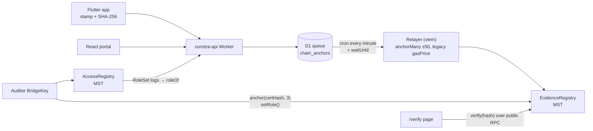
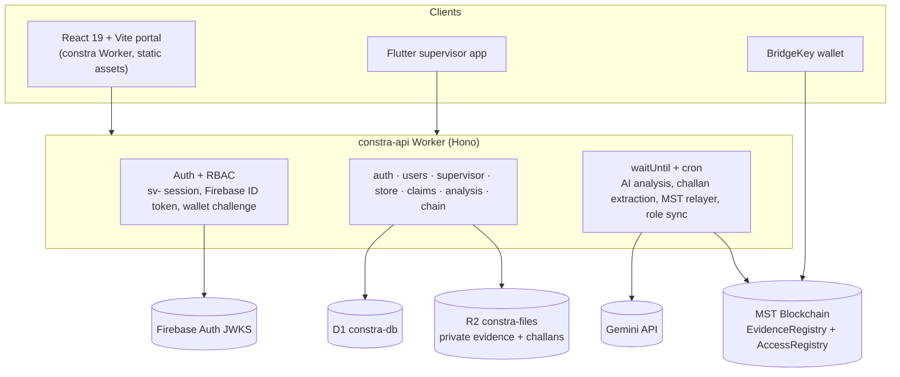
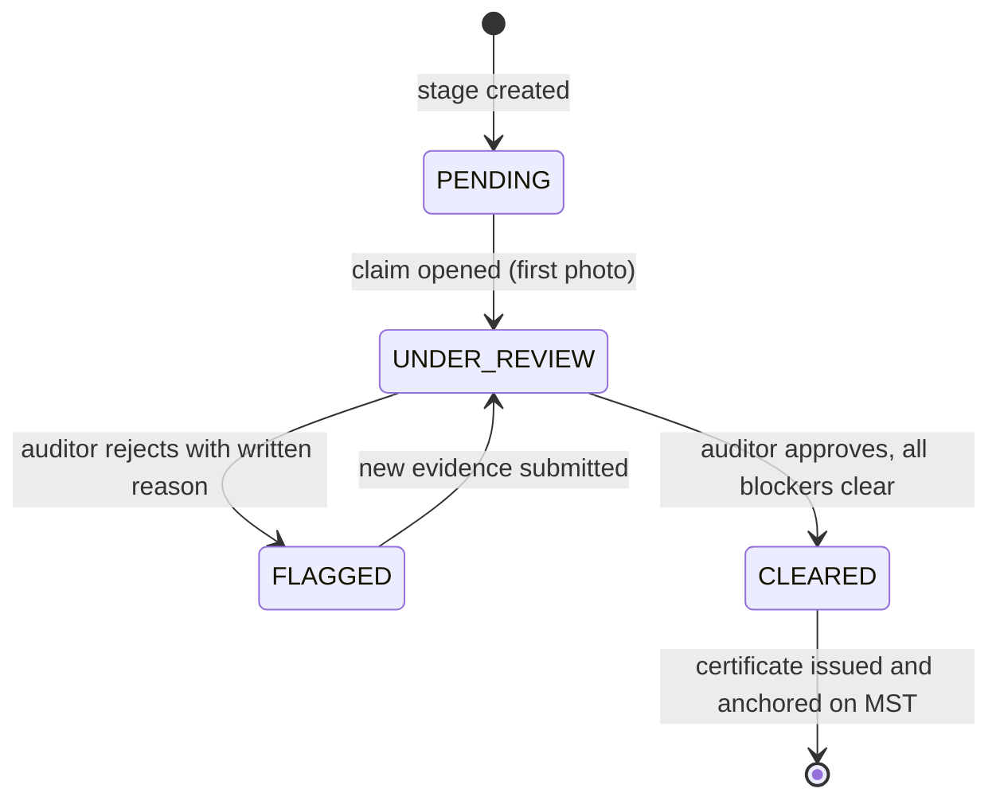

# CONSTRA: Construction Milestone Verifier on MST Blockchain

> Stops construction milestone fraud before money moves. Site photos, delivery challans and material issues are checked automatically (GPS geofence, SHA-256 integrity, AI vision, BOQ reconciliation, consumption anomalies), and every piece of evidence plus every clearance certificate is anchored on **MST Blockchain**, so anyone can prove later that nothing was swapped.

[](https://mstscan.com/address/0x9945391814a414c3cbcc0DDCBe98919Ab75c3F54)
[](#technology-stack)
[](#technology-stack)
[](mobile/README.md)
[](#submission-at-a-glance)

Built for **MST Buildathon 2.0**.

<p align="center">
  <a href="docs/media/constra-demo.mp4"></a>
  <br><sub>22-second overview (no audio). Click for the MP4.</sub>
</p>

---

## Submission at a glance

| Item | Link / value |
| --- | --- |
| Live web app | https://constra.pranavms09.workers.dev |
| Live API (health) | https://constra-api.pranavms09.workers.dev/health |
| Public proof checker | https://constra.pranavms09.workers.dev/verify (no login) |
| Try it without a wallet | Login page → choose a role → **Enter demo mode** |
| Source | https://github.com/Pranavms09/CONSTRA |
| Live app network | **MST mainnet** (chain `4646`); the earlier testnet deployment is kept for history |
| Wallet | BridgeKey (browser extension, EIP-6963); WalletConnect or QR pairing on the phone |
| Mobile app | Flutter supervisor app in [`mobile/`](mobile/README.md) (Android APK build) |

**MST mainnet (live)**

| Item | Link / value |
| --- | --- |
| `EvidenceRegistry` | [`0x9945391814a414c3cbcc0DDCBe98919Ab75c3F54`](https://mstscan.com/address/0x9945391814a414c3cbcc0DDCBe98919Ab75c3F54#code) (source verified; deploy tx [`0x924a22dd…3273`](https://mstscan.com/tx/0x924a22ddaa8bd76ebf302cea86469fe57635506e09b51f96d7e59ed9f8f33273)) |
| `AccessRegistry` | [`0x9b8d7e21f44DeCB92415F3644C0A0Ce831d63BF5`](https://mstscan.com/address/0x9b8d7e21f44DeCB92415F3644C0A0Ce831d63BF5#code) (source verified; Auditor grant tx [`0x4133a625…19fa6`](https://mstscan.com/tx/0x4133a625d66c8aac7fcdb1ecfab648e9455275e03349cf6f4e136741e2919fa6)) |
| App transaction | [`0xcd8de467…60e8`](https://mstscan.com/tx/0xcd8de46780d14f11cdb6bf5471fe14acd9f6dbb0f58776b9aea1cc28e33460e8): relayer `anchorMany` anchoring 3 evidence hashes (block 21731591) |

**MST testnet (history)**

| Item | Link / value |
| --- | --- |
| `EvidenceRegistry` | [`0x9945391814a414c3cbcc0DDCBe98919Ab75c3F54`](https://testnet.mstscan.com/address/0x9945391814a414c3cbcc0DDCBe98919Ab75c3F54#code) (source verified; same address as mainnet, same deployer and nonce) |
| `AccessRegistry` | [`0xBCC31B88E689a077F41a5718C853267262ac3373`](https://testnet.mstscan.com/address/0xBCC31B88E689a077F41a5718C853267262ac3373) |
| First app transaction | [`0xea286225…0f51`](https://testnet.mstscan.com/tx/0xea286225008721f688860b74d7f418fa126599accd6da5ecf70c798167bb0f51): relayer `anchorMany` for a site photo hash (block 6639012) |

---

## The problem

Contractors pay subcontractors per completed stage. Today the proof is a WhatsApp photo and a paper delivery slip:

- **Fabricated progress:** a stage is billed before the work is done.
- **Recycled or off-site photos:** old photos, photos from another site, or edited images.
- **Ghost and inflated deliveries:** challans that do not match the Bill of Quantities (BOQ).
- **Material leakage:** cement and steel issued far beyond what verified work needs.
- **Disputed records:** after payment, anyone with database access can quietly change the evidence.

## The solution

CONSTRA turns a milestone claim into an evidence pipeline with a hard gate at the end:

1. **Supervisor** captures stage photos in the CONSTRA app. The live GPS, time and site tag is burned into the JPEG, then the phone computes its SHA-256.
2. **API** re-hashes the upload, checks the geofence, stores the file privately in R2, raises alerts, and queues the hash for MST.
3. **AI vision** (Gemini) describes the construction stage and scores it for the auditor.
4. **Store In-Charge** uploads vendor challans. The text extractor reads them; a human confirms; the system reconciles against the BOQ and flags duplicates, bad dates, unapproved vendors and over-delivery.
5. **Material issues** are compared with photo-verified progress and with history (z-score); anomalies raise alerts.
6. **Auditor** reviews everything on the Claim Audit Desk. Approval is blocked while any blocker remains (open high/critical alert, failed geofence, missing photo, unconfirmed challan, self-approval).
7. **On approval**, a clearance certificate with a SHA-256 seal is issued and anchored on MST: signed by the auditor's BridgeKey wallet when one is linked, otherwise by the relayer.
8. **Anyone** can drop a file on `/verify` and check it against the MST contract directly.

---

## How MST Blockchain is used

MST is the trust layer, not a bolt-on. Three things live on-chain:

| On-chain | Contract | What it proves |
| --- | --- | --- |
| Evidence photo hashes (kind 1) | `EvidenceRegistry` | This exact photo existed at this block time and was not changed later |
| Delivery challan hashes (kind 2) | `EvidenceRegistry` | The confirmed challan file is the one that was reconciled |
| Clearance certificate hashes (kind 3) | `EvidenceRegistry` | The auditor's decision; sent from the auditor's own wallet when linked, else by the relayer |
| Portal role per wallet | `AccessRegistry` | Who is a supervisor, store in-charge or auditor; the source of truth for wallet sign-in |



- **Relayer:** the API Worker queues hashes in D1, then sends `anchorMany` batches (up to 50) with legacy `gasPrice` (MST has no EIP-1559), waits for receipts, retries failures and records tx hash and block.
- **Auditor certificates:** the auditor links a BridgeKey wallet by signature; the backend authorizes it on-chain with `setAnchorer`. The auditor signs `anchor(certificateHash, 3)` personally; the backend accepts it only after checking the receipt, sender and `Anchored` event.
- **Wallet sign-in:** `POST /auth/wallet/challenge` returns a single-use message bound to site, wallet, MST chain ID and expiry; after `personal_sign`, the server reads `AccessRegistry.roleOf` on MST. No role means no login. Role changes made with BridgeKey `setRole` reach D1 within one cron tick, and revocation deactivates the account.
- **Tamper detection:** `/chain/verify` compares D1 against the contract; a mismatch is logged as tampering. The `/verify` page reads the contract straight from the browser, so it does not trust our API.

Networks: testnet chain `91562037` (`https://testnetrpc.mstblockchain.com`, explorer https://testnet.mstscan.com); mainnet chain `4646` (`https://mariorpc.mstblockchain.com`, explorer https://mstscan.com). Details: [docs/CHAIN_INTEGRATION.md](docs/CHAIN_INTEGRATION.md), [docs/MST-BLOCKCHAIN.md](docs/MST-BLOCKCHAIN.md), [contracts/README.md](contracts/README.md).

---

## Architecture

Everything runs on Cloudflare's free plan: two Workers, one D1 database, one R2 bucket. Firebase is used only for Google sign-in; Gemini for vision and challan text extraction (Claude is an optional fallback for challan images when `ANTHROPIC_API_KEY` is set).



Component details and flows: [architecture.md](architecture.md).

---

## Features

### Site Supervisor (mobile app + web)
- Camera with live GPS HUD; mock locations blocked; a fresh GPS fix is required.
- GPS, time and site tag burned into the photo **before** hashing, so the on-chain hash covers the tag.
- Offline upload queue; idempotent uploads (`device_evidence_id`).
- Per-photo status: AI analysis and MST anchor (`queued → submitted → confirmed`) with explorer link.
- Sign in with email/password, BridgeKey on a computer (QR pairing with confirmation code), or a wallet on the phone (WalletConnect).
- Photos automatically join a per-stage claim on the auditor's Claim Audit Desk.

### Store In-Charge (web)
- Challan upload (photo or PDF) with automatic text extraction, fuzzy vendor/material matching and low-confidence fields highlighted for review.
- Optimistic locking on edits; confirm runs BOQ reconciliation with unit normalization (bags, kg, tonnes).
- Alerts: `duplicate_challan` (high), `boq_over_delivery` (high), `challan_date_invalid` (medium), `unapproved_vendor` (medium).
- Material issue with live anomaly preview; stock summary, BOQ progress, issue history.

### Project Auditor (web)
- Claim Audit Desk: per-field agree / amend / flag, photo evidence, AI report, EXIF GPS check, anchor status.
- Clearance gate with explicit blockers; mandatory reason (≥5 chars) to reject.
- Certificate with SHA-256 seal, printable, anchored on MST from BridgeKey.
- Alert triage (only auditors resolve/escalate; justification required), challan review, EXIF & GPS tool.
- User access: create accounts, assign projects, grant/revoke on-chain roles with BridgeKey `setRole`.

### Anyone
- `/verify`: hash a file in the browser and check it against `EvidenceRegistry` on MST.

---

## Fraud checks

| Threat | Check | Result |
| --- | --- | --- |
| Photo taken off-site | Haversine distance vs project radius (default 200 m); GPS accuracy widens it by at most 50 m | `GEOFENCE_VIOLATION` alert (high); approval blocked |
| Photo altered in transit | Server SHA-256 vs phone SHA-256 | `HASH_MISMATCH` alert (critical) |
| Old or future-dated photo | EXIF capture time vs upload time (default 24 h) | EXIF check fails |
| Wrong work in the photo | AI vision report against the stage | Shown to the auditor with confidence |
| Duplicate or reused challan | Same file hash or same vendor + challan number | `duplicate_challan` alert |
| Inflated delivery | Delivered vs BOQ, tolerance 5% | `boq_over_delivery` alert |
| Material diversion | Cumulative issue vs planned × verified progress (+15%); `|z| > 2.5` once 5+ days of history exist | `consumption_anomaly` alert |
| Self-approval | Approver ≠ submitter (id, email, name) | 403 |
| Evidence swapped after approval | Hash anchored on MST; D1 vs chain comparison | Tampering logged; `/verify` fails |
| Role escalation | Roles read from D1 (mirrors `AccessRegistry`), never from the client | 403 |

Thresholds (`boq_tolerance_pct`, `expected_usage_tolerance`, `zscore_limit`, `site_radius_m`) are stored per project in D1.

---

## Milestone state machine



---

## Roles and permissions

| Capability | Supervisor | Store In-Charge | Auditor |
| --- | :---: | :---: | :---: |
| See assigned projects and stages | ✅ | ✅ | ✅ (all) |
| Upload stage photos | ✅ | | |
| Upload/confirm challans, issue material | | ✅ | |
| View challans, stock, BOQ, alerts | | ✅ | ✅ |
| Acknowledge alerts | | ✅ | ✅ |
| Resolve/escalate alerts | | | ✅ |
| Approve/reject claims, issue certificates | | | ✅ (not own submissions) |
| Manage users, projects, on-chain roles | | | ✅ |

Accounts are created by an auditor only (no self sign-up). Site roles see only projects they are members of; other projects return 404.

---

## Technology stack

| Layer | Choice |
| --- | --- |
| Web | React 19, Vite, Tailwind CSS, GSAP, Lenis; served by a Cloudflare Worker (static assets, SPA fallback) |
| Mobile | Flutter (camera, geolocator, `flutter_secure_storage`, WalletConnect `reown_sign`) |
| API | Cloudflare Workers + Hono (TypeScript), cron trigger every minute |
| Data | Cloudflare D1 (SQLite), R2 (private files with SHA-256 checksums) |
| AI | Gemini `gemini-2.5-flash` via Files API (vision + challan extraction); optional Claude fallback for challan images |
| Forensics | exifr, Haversine, z-scores, rapidfuzz port for fuzzy matching |
| Auth | Firebase ID tokens verified with `jose`; HMAC `sv-` sessions (24 h); PBKDF2 passwords; wallet challenge + `AccessRegistry` |
| Chain | MST Blockchain, Solidity 0.8.24, Hardhat, viem, BridgeKey |

---

## Repository layout

```
CONSTRA/
├── backend/            Cloudflare Worker API (Hono + D1 + R2 + MST relayer)
│   ├── src/routes/     auth, users, pings, supervisor, store, claims, analysis, chain
│   ├── src/services/   store domain (units, reconcile, anomaly, extraction), chain relayer
│   ├── src/lib/        exif, gemini, fuzzy, util (SHA-256, MIME sniffing)
│   ├── migrations/     D1 schema 0001–0009 + demo seed (0009: mainnet re-anchor)
│   └── test/           vitest (33 tests)
├── frontend/           React portal (supervisor, store, auditor, /verify, /wallet-pair)
├── mobile/             Flutter supervisor app
├── contracts/          EvidenceRegistry + AccessRegistry (Hardhat, 23 tests)
├── docs/               PRD, TRD, design, security, schema, chain docs
├── scripts/            check-docs.sh (doc word limits + links)
├── wrangler.json       frontend Worker (static assets)
└── architecture.md     system architecture
```

---

## API overview

Errors return `{"detail": ...}`. All routes except those marked Public need `Authorization: Bearer <token>`.

| Method | Endpoint | Access | Purpose |
| --- | --- | --- | --- |
| `GET` | `/health` | Public | Health + AI configured |
| `POST` | `/auth/login`, `/auth/login-password` | Public (rate limited) | Firebase or email/password sign-in → `sv-` session |
| `POST` | `/auth/demo-login` | Public (only when `DEMO_MODE=true`) | One-click demo session per role |
| `POST` | `/auth/wallet/challenge`, `/auth/wallet/login` | Public (rate limited) | BridgeKey sign-in checked against `AccessRegistry` |
| `POST` | `/auth/wallet/pair`, `/auth/wallet/pair/{id}/approve`, `/auth/wallet/pair/{id}/claim` | Public / wallet | Phone QR pairing |
| `POST` | `/auth/password` · `GET /auth/me` | Any user | Set app password · current user |
| `GET/POST/PATCH/DELETE` | `/users[/{id}]` | Auditor | Accounts and project membership |
| `GET` | `/supervisor/projects`, `/projects/{pid}/stages`, `/dashboard` | Supervisor | Assigned work |
| `POST/GET` | `/supervisor/evidence[/{id}[/retry-ai, /retry-anchor, /anchor, /file]]` | Supervisor (file: + Auditor) | Photo upload and status |
| `GET` | `/store/projects`, `/materials`, `/vendors`, `/projects/{pid}/{stages,materials,vendors}` | Any role | Reference data |
| `GET` | `/store/projects/{pid}/{challans,material-issues,stock-summary,boq-status,alerts}`, `/store/challans/{id}`, `/store/files/{id}` | Store, Auditor | Lists, stock, BOQ, private challan file |
| `POST` | `/store/projects/{pid}/challans[/manual]`, `/store/challans/{id}/confirm` | Store In-Charge | Challan upload, confirm + reconcile |
| `POST` | `/store/issue-preview`, `/store/stages/{sid}/material-issues` | Store In-Charge | Anomaly preview, material issue |
| `PATCH/POST` | `/store/alerts/{id}[/action]` | Auditor (Store: acknowledge only) | Resolve/escalate with justification (≥5 chars) |
| `GET/POST` | `/api/v1/claims[/{id}]` | Any user / Supervisor | Claims list, create |
| `POST` | `/api/v1/claims/{id}/commands`, `/decisions`, `/submit` | Auditor | Field decisions, approve/reject through the gate |
| `GET` | `/api/v1/claims/{id}/certificate`, `/api/v1/stages/{id}/certificate` | Any user | Clearance certificate |
| `POST` · `GET` | `/api/analyze-image` · `/api/analyses` | Any user (analyze: 10/min) | AI description + EXIF report · past analyses |
| `GET` | `/api/v1/projects/{pid}/evidence/{file}/exif-gps` | Auditor | EXIF & GPS check for one photo |
| `GET` | `/chain/config` · `GET/POST /chain/verify[/{sha256}]` | Public (rate limited) | Network info · on-chain verification |
| `GET/POST` | `/chain/wallet/message`, `/chain/wallet` | Any user | Link wallet (auditor: + `setAnchorer`) |
| `POST` | `/chain/certificates/{id}/onchain`, `/chain/process`, `/chain/roles/sync`, `/chain/anchors/{id}/retry` | Auditor | Certificate tx, run relayer, sync roles, retry |
| `GET` | `/chain/anchors/{entity}/{id}` · `/chain/status` | Any user · Auditor | Anchor status · relayer health |

Full list: [docs/TRD.md](docs/TRD.md#api).

---

## Run locally

Prerequisites: Node.js 20+, npm; Flutter 3 for the mobile app.

```bash
# API (http://localhost:8787; use --port 8788 if 8787 is busy)
cd backend
npm install
cp .dev.vars.example .dev.vars      # SECRET_KEY, GEMINI_API_KEY; DEMO_MODE=true; CHAIN_MODE=fake for no wallet
npm run db:migrate:local            # schema + demo project, stages, BOQ, users
npm run dev
npm test

# Web (http://localhost:5173)
cd ../frontend
cp .env.example .env                # VITE_API_BASE_URL=http://localhost:8787
npm install && npm run dev

# Contracts
cd ../contracts && npm install && npm test

# Mobile
cd ../mobile && flutter pub get && flutter test
flutter run --dart-define=API_BASE_URL=http://10.0.2.2:8787
```

**Demo mode (on in production for judging):** pick a role on the login page and click **Enter demo mode**; no wallet or account needed. Demo sessions run the full workflow (uploads, challans, approvals, real MST anchors) but cannot manage users, set passwords or link wallets. Set `DEMO_MODE="false"` in `backend/wrangler.json` to turn it off.

## Deploy (Cloudflare free plan)

Run these yourself; nothing here logs in for you.

```bash
npx wrangler login
cd backend
npx wrangler d1 create constra-db          # put database_id in backend/wrangler.json
npx wrangler r2 bucket create constra-files
npx wrangler secret put SECRET_KEY
npx wrangler secret put GEMINI_API_KEY
npx wrangler secret put ANCHOR_PRIVATE_KEY  # MST relayer = EvidenceRegistry owner
cd ../contracts && cp .env.example .env     # PRIVATE_KEY = your own new wallet (same as relayer), fund from https://faucet.mstblockchain.com
npm install
npm run deploy:testnet                      # EvidenceRegistry → CONTRACT_ADDRESS
npm run deploy:access:testnet               # AccessRegistry → ACCESS_REGISTRY_ADDRESS, ACCESS_REGISTRY_FROM_BLOCK (deploy block)
cd .. && npm run deploy                     # D1 migrations + API + frontend
```

Addresses are written to `contracts/deployments.json`; copy them into `backend/wrangler.json` `vars` before `npm run deploy`.

Mainnet (what the live app uses):

```bash
cd contracts
CONFIRM_MAINNET="yes, deploy to mainnet" npm run deploy:mainnet
CONFIRM_MAINNET="yes, deploy to mainnet" npm run deploy:access:mainnet
WALLET=0x... ROLE=3 npm run set-role:mainnet   # 1 supervisor, 2 store in-charge, 3 auditor, 0 revoke
```

Then set `MST_NETWORK=mainnet`, `MST_CHAIN_ID=4646`, `MST_RPC_URL=https://mariorpc.mstblockchain.com`, `MST_EXPLORER_URL=https://mstscan.com`, `CONTRACT_ADDRESS`, `ACCESS_REGISTRY_ADDRESS` and `ACCESS_REGISTRY_FROM_BLOCK` in `backend/wrangler.json`, and redeploy. More: [docs/TRD.md](docs/TRD.md#deployment).

---

## Demo walkthrough (about 3 minutes)

1. **Supervisor (phone):** sign in, pick the Nashik project and a stage, take a photo. The tag is stamped and hashed on the phone.
2. **Upload:** the photo shows AI status and anchor status; open the MSTScan link once it is `confirmed`.
3. **Off-site photo:** a photo outside the geofence raises `GEOFENCE_VIOLATION`.
4. **Store In-Charge:** upload a challan; review extracted fields; confirm. A quantity above the BOQ raises `boq_over_delivery`.
5. **Material issue:** issue more cement than verified progress allows; the preview warns and `consumption_anomaly` is raised.
6. **Auditor:** open the claim on the Claim Audit Desk. Approval is blocked with the list of blockers.
7. **Resolve and approve:** resolve alerts with justification, approve; sign the certificate anchor with BridgeKey (in demo mode the relayer anchors it).
8. **Verify:** drop the photo on `/verify` → found on MST with block time. Change one pixel → not found.

---

## Testing

| Suite | Command | Result |
| --- | --- | --- |
| Backend (vitest) | `cd backend && npm test` | 33/33 pass; `tsc` clean |
| Contracts (Hardhat) | `cd contracts && npm test` | 23/23 pass |
| Mobile (Flutter) | `cd mobile && flutter test` | 5/5 pass; `flutter analyze` clean |
| Frontend | `npm run build` | builds |
| On-chain | testnet and mainnet txs above | anchor + `verify()` authentic |

Not yet verified end to end: BridgeKey sign-in with a real wallet on web and phone, auditor `setRole` / "Grant on MST" from the production UI, mobile app on a physical device, the full per-role flow on mainnet. See [progress.md](progress.md).

---

## Limitations

- The live app runs on MST mainnet. Hashes first anchored on testnet were re-anchored on mainnet (migration `0009`); their testnet txs remain on testnet.mstscan.com.
- AI vision results are advisory for the auditor; they do not raise alerts on their own.
- Background AI and text extraction use `ctx.waitUntil` (about 30 s); stuck challans are retried by cron. Cloudflare Queues is the upgrade path.
- The free plan allows about 10 ms CPU per request, so images are never decoded or resized in the Worker.

---

## Documentation

| Doc | Content |
| --- | --- |
| [docs/README.md](docs/README.md) | Index of all docs |
| [architecture.md](architecture.md) | Components, flows, trust boundaries |
| [docs/PRD.md](docs/PRD.md) | Product requirements |
| [docs/TRD.md](docs/TRD.md) | Technical requirements, API, configuration, deployment |
| [docs/DESIGN.md](docs/DESIGN.md) | Software design and key decisions |
| [docs/UI-UX.md](docs/UI-UX.md) | Screens, journeys, design tokens |
| [docs/DB-SCHEMA.md](docs/DB-SCHEMA.md) | D1 schema |
| [docs/SECURITY.md](docs/SECURITY.md) | Threat model and controls |
| [docs/CHAIN_INTEGRATION.md](docs/CHAIN_INTEGRATION.md) | MST relayer, wallet flows, verification |
| [docs/MST-BLOCKCHAIN.md](docs/MST-BLOCKCHAIN.md) | MST networks, gas model, Buildathon checklist |
| [progress.md](progress.md) | Current status |
